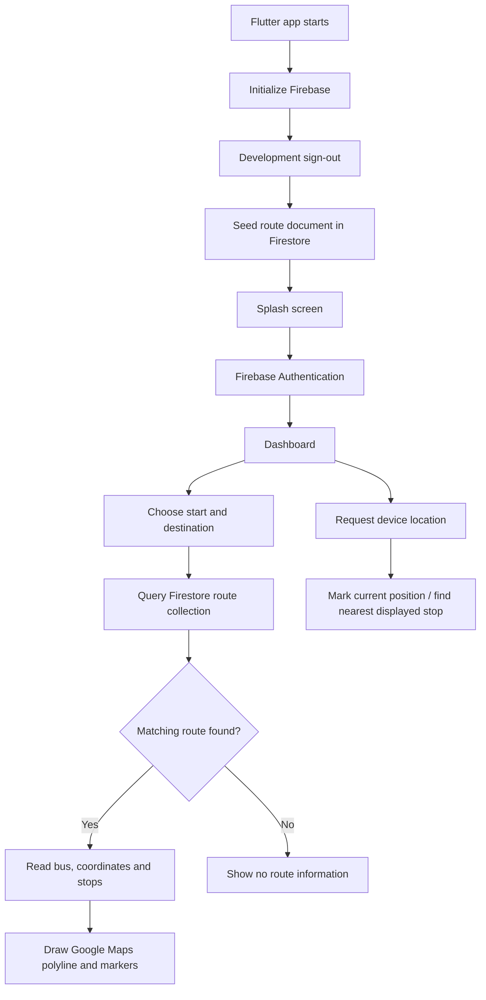

# 🚌 Bus Route Finder

A Flutter mobile application prototype for exploring predefined bus routes in Kathmandu. Users can create an account, choose a start and destination, view a stored route and its stops on Google Maps, and use their device location to identify a nearby stop.

> **Project status:** This repository contains a working prototype structure and a small seeded route dataset. It is not a live vehicle-tracking system, and route coverage is limited to records added to Cloud Firestore.

## What problem does it address?

Finding a bus service and understanding where it travels can be difficult when route and stop information is scattered. Bus Route Finder brings route selection, bus-service details, stop locations, and a map view into one mobile interface.

## Features

- **Account access:** email/password registration, login, password reset, and logout using Firebase Authentication.
- **Route selection:** searchable start and destination dropdowns populated with a fixed list of Kathmandu-area locations.
- **Route visualization:** retrieves a matching route from Cloud Firestore and draws its stored coordinates as a map polyline.
- **Stop markers:** displays the route's start, end, and intermediate bus stops.
- **Bus service information:** displays the bus name stored with the selected route.
- **Current location:** requests device location permission and places a marker at the user's location.
- **Nearest stop:** identifies the closest displayed route stop to the user's current location.
- **Route controls:** swap the selected endpoints or clear the current route and markers.
- **Separate directions screen:** `LiveDirectionsPage` contains a Google Directions API request and a step list. It is not currently linked from the main dashboard.

## How it works



The route shown on the dashboard is **not calculated from a live directions service**. It is drawn from the `coordinates` array saved in Firestore. The separate `LiveDirectionsPage` makes a Directions API request, but the dashboard does not navigate to that page in the current implementation.

## Technology stack

| Area | Libraries / services |
|---|---|
| App framework | Flutter, Dart |
| Authentication | Firebase Authentication |
| Route storage | Cloud Firestore |
| Map display | `google_maps_flutter` |
| Device location | `location`, `permission_handler` |
| Route selection | `dropdown_search` |
| Directions screen | Google Directions API, `http` |
| Firebase setup | `firebase_core`, FlutterFire configuration |

Other packages are listed in `pubspec.yaml`, including Firebase Storage and Messaging, `geolocator`, `flutter_polyline_points`, and `url_launcher`. Their presence in the dependency list does not mean they are all used by the current dashboard flow.

## Repository structure

```text
lib/
├── main.dart                 # Firebase initialization and app entry point
├── splash_screen.dart        # Startup screen and auth-based navigation
├── login_page.dart           # Email/password login
├── signup_page.dart          # Account registration
├── forgot_password_page.dart # Password reset
├── dashboard1.dart           # Map, route selectors and location controls
├── route_utils.dart          # Firestore route lookup/save and map overlays
├── route_uploader.dart       # Seeds the sample Kalanki–Gongabu route
├── live_directions_page.dart # Separate Google Directions API screen
└── firebase_options.dart     # FlutterFire platform configuration

assets/
├── bus.png
├── bus1.png
├── bus2.png
└── bu.png

android/  ios/  web/  linux/  macos/  windows/
```

Firebase options in the supplied project are configured for Android and iOS. The current `firebase_options.dart` explicitly does not configure web, Windows, Linux, or macOS.

## Firestore data model

The app reads from the **`route`** collection. Each route document is expected to contain:

```json
{
  "start": "Kalanki",
  "end": "Gongabu New Bus Station Parking, Kathmandu 44600",
  "bus": "Mahanagar Yatayat",
  "coordinates": [
    { "Lat": 27.693148, "Lng": 85.280928 },
    { "Lat": 27.693328, "Lng": 85.281797 }
  ],
  "stops": [
    {
      "Lat": 27.704174,
      "Lng": 85.282102,
      "title": "Soaltee Dobato Chowk"
    }
  ]
}
```

- `start` and `end` must match the selected dropdown labels exactly.
- `bus` is the service name displayed for the route.
- `coordinates` is an ordered list of latitude/longitude points used to draw the polyline.
- `stops` is a list of stop coordinates and marker titles.

The bundled `RouteUploader` writes a sample route for **Kalanki → Gongabu New Bus Station Parking**. The dashboard's location dropdown also lists Maitidevi, Lagankhel, and Bhaktapur (Sanothimi), but a location appearing in the dropdown does not mean a route to or from it exists in Firestore.

## Getting started

### Prerequisites

- Flutter SDK (compatible with the Dart constraint in `pubspec.yaml`).
- Android Studio or VS Code with Flutter/Dart tooling.
- An Android device or emulator (or an iOS device with Xcode on macOS).
- A Firebase project with **Email/Password Authentication** and **Cloud Firestore** enabled.
- A Google Maps API key with the relevant Maps SDK enabled for the target platform.

### 1. Clone the repository

```bash
git clone https://github.com/Dhiru767/bus-route-finder-main.git
cd bus-route-finder-main
```

### 2. Install dependencies

```bash
flutter pub get
```

### 3. Configure Firebase

Install and use the FlutterFire CLI for your own Firebase project:

```bash
dart pub global activate flutterfire_cli
flutterfire configure
```

Enable Email/Password sign-in in Firebase Authentication and create a Cloud Firestore database. For Android, ensure the matching `google-services.json` is generated/downloaded for your app's Android application ID. Do not reuse another developer's Firebase project configuration.

### 4. Configure Google Maps

For Android, add your own restricted Maps SDK for Android key to the `com.google.android.geo.API_KEY` metadata entry in `android/app/src/main/AndroidManifest.xml`.

The separate `lib/live_directions_page.dart` also currently contains a hard-coded Directions API key. Replace this implementation with a secure configuration appropriate to your deployment. For production, prefer calling the Directions API through a backend rather than shipping an unrestricted web-service key inside a mobile app. Restrict keys by API and application, monitor usage, and set billing/quota alerts.

**Security note:** API-key values and Firebase project configuration were present in the supplied source. Treat any key that has been committed publicly as exposed: rotate it where appropriate and apply API/application restrictions. Do not copy keys from the repository into your own deployment.

### 5. Run the app

```bash
flutter run
```

To build an Android release APK:

```bash
flutter build apk --release
```

## Using the app

1. Launch the app and register with an email address and password, or sign in.
2. Choose a starting point and destination from the dropdowns.
3. Tap **Show Route** to query Firestore.
4. If a matching route exists, inspect the polyline, start/end markers, intermediate stops, and bus-service name on the map.
5. Tap **My Location** to request location access and centre the map on your position.
6. Tap **Nearest Stop** after a route and its stop markers are displayed.
7. Use the swap control to reverse the selected endpoints, or **Clear** to reset the route display.
8. Use the logout icon to sign out.

## Example route record

A route record with `start = "Kalanki"` and `end = "Gongabu New Bus Station Parking, Kathmandu 44600"` is seeded by `RouteUploader`. Its bus field is `Mahanagar Yatayat`. Selecting those exact values is the example lookup supported by the bundled seed data.

If no exact Firestore match is found, the route utility clears the overlays and the dashboard displays that no bus information is available. The application does not currently calculate alternative routes.

## Important implementation notes and limitations

- **Development sign-out:** `main.dart` calls `FirebaseAuth.instance.signOut()` every time the app starts. This intentionally forces the login flow during development, but it also prevents a persisted session from being used on the next launch. Remove this behavior before treating the app as a normal authenticated release.
- **Seed upload at startup:** `main.dart` calls the route uploader during every launch. It writes to a fixed Firestore document ID using `set`, so it overwrites that document rather than acting as a one-time migration. Move seeding to an explicit admin/setup operation for production.
- **Limited route coverage:** the dashboard uses a fixed list of five location labels and the bundled uploader supplies one sample route. Other pairs require correctly structured Firestore records.
- **Exact direction matching:** the query matches `start` and `end` exactly. A reverse route is a separate record unless explicitly added.
- **Nearest-stop behavior:** the nearest-stop calculation uses the markers currently loaded for the displayed route. A route should be loaded before using this feature.
- **No live vehicle positions:** the project does not show GPS positions of buses, arrival estimates, schedules, or fares.
- **Directions screen integration:** the Directions API screen is separate from the main dashboard and its request/error handling should be strengthened before production use.
- **Automated tests:** the checked-in widget test is still the default Flutter counter smoke-test template; it does not validate authentication, Firestore route retrieval, map rendering, or nearest-stop behavior.
- **Production readiness:** add robust error/loading states, validate Firestore documents, review Firestore security rules, move route seeding out of app startup, protect API keys, and add meaningful unit/widget/integration tests.

## Future improvements

- Add verified routes, stops, service operators, fares, and timetable information.
- Support reverse-direction and multi-leg route search.
- Add admin tooling for maintaining route data.
- Add live bus GPS tracking and arrival estimates if a reliable vehicle-location data source becomes available.
- Connect the directions screen to the dashboard and improve API error handling.
- Add route-search, Firestore parsing, authentication, and location tests.
- Improve accessibility, offline behavior, and user-facing permission/error messages.

## License

See the [LICENSE](LICENSE) file.
